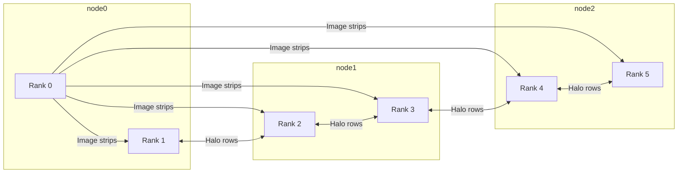
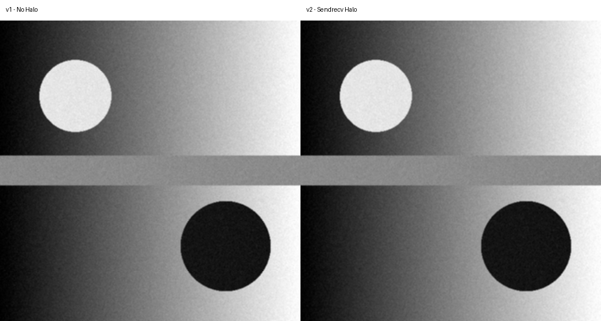

# Parallel Image Filtering with MPI

## SCx61 Week 2 - MPI Point-to-Point Communication


This project demonstrates parallel image filtering using MPI across three Docker containers. I learned how halo exchange fixes image boundary errors and how blocking MPI communication can cause a deadlock.


**Course:** SCx61 Distributed Computing

**Week:** 2 - MPI Point-to-Point

**Bonus extension:** E2 - Finding the Hang Boundary


---


## 1. The Problem


The program divides a grayscale image into horizontal strips and distributes them across six MPI ranks.


A 3x3 box blur needs the row above and the row below each pixel. In version 1, each rank processes its strip without receiving neighbouring rows. This causes incorrect results at the boundaries between strips.


I compared the parallel output with a serial reference produced by `filter_ref.py`. The serial implementation processes the entire image without splitting it, making it a useful correctness reference.


My measurements showed:


- Version 1: 4188 differing pixels.

- Version 2: 0 differing pixels.


The incorrect rows in version 1 were:


85-86, 171-172, 256-257, 341-342 and 426-427.


---


## 2. Architecture


The cluster contains three Docker containers and six MPI ranks.


- node0: ranks 0 and 1

- node1: ranks 2 and 3

- node2: ranks 4 and 5


The hostfile controls how MPI processes are distributed across the nodes.


Rank 0 reads the image, divides it into horizontal strips and distributes the strips to the other ranks.


Each rank applies the image filter to its assigned strip. In version 2, neighbouring ranks exchange halo rows using `MPI.Sendrecv`.


The exchanged halo buffers contain one grayscale image row, with one byte per pixel. The program also uses MPI messages to distribute strips and collect the processed results.


Finally, rank 0 combines the results and saves the output image.





---


## 3. How to Run


### Requirements


- Docker Desktop

- Docker Compose

- Open MPI inside the course containers

- Python 3

- NumPy

- Pillow


The project was developed using Windows, VS Code and Docker Compose.


### Start the cluster


From the `lab/config` directory:


```bash

docker compose up -d --build

docker compose ps

```


Check that node0, node1 and node2 are healthy.


Enter node0 as the student user:


```bash

docker compose exec -u student -w /home/student/work node0 bash

```


### Generate the test image


Inside node0:


```bash

python3 make_test_image.py --width 512 --height 300 --out-prefix test_image

```


Generate the serial reference:


```bash

python3 -c "import numpy as np; from filter_ref import box_blur_3x3; np.save('test_image_filtered_serial.npy', box_blur_3x3(np.load('test_image.npy')))"

```


### Run version 1


```bash

mpirun --hostfile hostfile -n 6 python3 img_mpi_v1_nohalo.py


python3 compare.py --candidate test_image_filtered_v1

```


### Run version 2


```bash

mpirun --hostfile hostfile -n 6 python3 img_mpi_v2_halo.py


python3 compare.py --candidate test_image_filtered_v2

```


These commands were used in the course lab environment.


A fresh-clone verification has not yet been completed.


---


## 4. Results


The test image contained 262144 pixels.


| Version | Differing pixels | Differing rows |

|---|---:|---|

| v1 - No halo | 4188 | 85-86, 171-172, 256-257, 341-342, 426-427 |

| v2 - Sendrecv halo | 0 | None |


The comparison showed that version 1 produced incorrect pixels at strip boundaries.


Version 2 exchanged halo rows before filtering and matched the serial reference exactly.


### Visual comparison





The image shows the outputs side by side.


The boundary errors are subtle in the full image, so the numerical comparison is the stronger evidence.


---


## 5. Investigating the MPI Deadlock


The course lab included a naive MPI halo exchange implementation that could hang.


In the naive implementation, ranks attempted blocking sends before posting the matching receives.


When the messages became large enough, the program could stop making progress because the processes were waiting for communication to complete.


### Evidence


I ran the naive program on an image with width 8192.


All six ranks printed:


`before Send`


The program did not reach the expected `after Send` messages before the timeout.


The timeout confirmed that the program was hanging.


### Testing synchronous sends


I also tested a version using `MPI.Ssend` on an image with width 256.


The program hung even at this smaller width.


The exit code was:


`124`


This supported the explanation that the naive communication order depended on MPI buffering.


### Testing the eager limit


I tested an increased eager limit:


```bash

--mca btl_vader_eager_limit 16384

```


The naive program completed at width 8192 under this configuration.


However, when I tested width 20000, the program hung again with exit code 124.


This showed that increasing the eager limit only hid the symptom for some message sizes. It did not fix the unsafe communication order.


### Verifying the fix


I ran:


```bash

bash verify_fix.sh

```


The corrected version used `MPI.Sendrecv`.


I repeated the verification three times.


Each run completed and produced:


```text

np.array_equal: True

Differing pixels: 0 / 2457600

0 differing pixels — exact match with the serial oracle.

```


This confirmed that the corrected communication approach worked on the 8192-wide image.


The naive deadlock program and Break Kit scripts are course materials and are not included in this public repository.


---


## 6. Bonus Extension E2 - Finding the Hang Boundary


### Objective


I investigated the image width at which the naive MPI halo exchange began to hang on my setup.


The purpose was to demonstrate that the hang boundary depends on the MPI implementation and runtime configuration.


### Prediction


Before testing, I predicted that the first hanging width would be 4096 pixels.


### Environment


- Windows host computer

- Docker Desktop and Docker Compose

- Three containers: node0, node1 and node2

- Six MPI ranks

- Open MPI inside the containers

- Image height: 300 pixels

- Timeout: 10 seconds per run


### Experiment


I generated images with different widths and ran the naive MPI program.


The test command was:


```bash

timeout 10 mpirun --hostfile hostfile -n 6 python3 img_mpi_v3_naive_halo.py sw_$W sw_${W}_out

```


An exit code of 0 means the program completed.


An exit code of 124 means the timeout stopped the program.


### Measurements


| Width | Exit code | Result |

|---:|---:|---|

| 256 | 0 | Completed |

| 1024 | 0 | Completed |

| 2048 | 0 | Completed |

| 2560 | 0 | Completed |

| 3072 | 0 | Completed |

| 3584 | 0 | Completed |

| 3712 | 0 | Completed |

| 3840 | 0 | Completed |

| 3968 | 0 | Completed |

| 4000 | 0 | Completed |

| 4032 | 0 | Completed |

| 4040 | 0 | Completed |

| 4041 | 124 | Timed out |

| 4042 | 124 | Timed out |

| 4043 | 124 | Timed out |

| 4044 | 124 | Timed out |

| 4045 | 124 | Timed out |

| 4046 | 124 | Timed out |

| 4047 | 124 | Timed out |

| 4048 | 124 | Timed out |

| 4056 | 124 | Timed out |

| 4064 | 124 | Timed out |

| 4096 | 124 | Timed out |

| 8192 | 124 | Timed out |


### Repeated verification


I repeated the tests at widths 4040 and 4041 three times each.


| Width | Run 1 | Run 2 | Run 3 |

|---:|---:|---:|---:|

| 4040 | 0 | 0 | 0 |

| 4041 | 124 | 124 | 124 |


The narrowest boundary identified in my experiments was between widths 4040 and 4041.


Width 4040 completed successfully in all three repeated runs.


Width 4041 timed out in all three repeated runs.


### What surprised me


I expected the naive program to begin hanging at width 4096.


Instead, my measurements showed that it started hanging at width 4041.


This demonstrated that the hang boundary is sensitive to message size and the MPI runtime environment.


The number 4041 is an experimental observation on my setup, not a universal MPI constant.


A classmate using a different MPI build, configuration or machine may observe a different boundary.


### Evidence files


The detailed extension report is available here:


[EXTENSION.md](lab/work/EXTENSION.md)


The repeated experiment output is available here:


[E2_evidence.txt](lab/work/E2_evidence.txt)


---


## 7. AI Usage


I used AI to help explain MPI communication concepts, suggest debugging experiments and organize my observations.


I verified the suggestions against actual terminal output.


One suggestion investigated during the lab was increasing the MPI eager limit. Although this allowed one test to finish, further testing showed that it did not solve the underlying deadlock.


The conclusions in this report are based on the experiments and outputs recorded during the lab.


---


## 8. What I Would Do Next


- Test the corrected MPI implementation with additional image sizes.

- Investigate non-blocking communication using `MPI.Isend` and `MPI.Irecv`.

- Compare correctness and performance after collecting reliable timing measurements.


---


## Credits


SCx61 Distributed Computing: Norhan Saber (Teaching Assistant), Scientific Computing Department, Faculty of Computers and Artificial Intelligence, Benha University.


The Docker cluster configuration and original lab materials were provided as part of the SCx61 course.


This repository documents my learning experiments and measurements.
